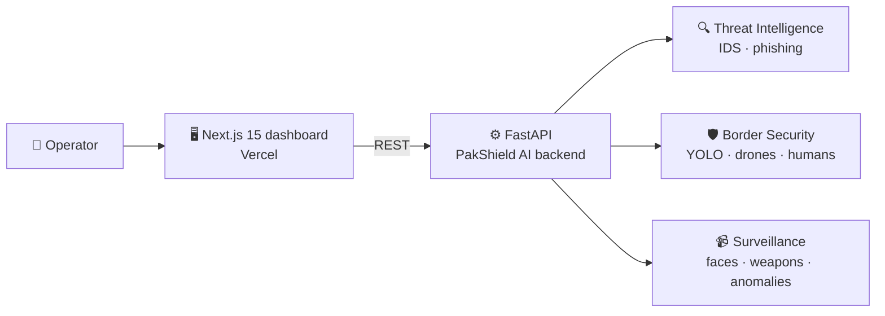

<!-- PakShield AI Web · README by Usama Shahid (fewgets) -->
<div align="center">


<p>
  
  
  
  
  
  
</p>

<p>
  <a href="https://pak-shield-ai.vercel.app"><b>🌐 Live Demo</b></a> · <a href="https://github.com/fewgets/PakShield_Defence_AI"><b>🧠 AI Backend</b></a>
</p>

</div>

---
## 📌 Overview

This is the **web command centre** for **[PakShield Defence AI](https://github.com/fewgets/PakShield_Defence_AI)**,
an AI-powered cyber-defence and surveillance platform built for the **Uraan Pakistan National Hackathon**.

The dashboard brings all of PakShield's AI modules into one modern, responsive interface. Operators
can upload emails, network logs, images or videos and see **threats, detections and alerts** in real time.

> 🌐 **Live:** [pak-shield-ai.vercel.app](https://pak-shield-ai.vercel.app)

---

## 🎯 Modules

| Module | Capabilities | Backend Endpoint |
|---|---|---|
| 🔍 **Threat Intelligence** | Phishing email detection, network intrusion detection (IDS) | `/email-classify` · `/ids-predict` |
| 🛡️ **Border Security** | Drone detection, human detection, suspicious-activity tracking | `/border/drones/detect` · `/border/humans/detect` · `/border/suspicious/detect` |
| 📹 **AI Surveillance** | Face recognition, weapon detection, anomaly detection | `/surveillance/face/recognize` · `/surveillance/weapon/detect` · `/surveillance/anomaly/detect` |

---

## ✨ Features

- 🌗 **Dark and light themes** with system detection
- 📱 **Fully responsive**, from mobile to command-room screens
- 📊 **Interactive charts** and live data visualisation (Recharts)
- ⚡ **Fast data fetching** and caching with SWR
- 🎞️ **Smooth animations** with Framer Motion
- ♿ **Accessible components** built on Radix UI / shadcn/ui
- 🔐 **Auth-ready** route structure (`(auth)` and `(dashboard)` groups)
- 🔌 **Configurable API**: point the dashboard at any PakShield backend via a single JSON config

---

## 🏗️ Architecture



---

## 🛠️ Tech Stack

| Category | Technologies |
|---|---|
| Framework | Next.js 15 (App Router), React 19, TypeScript |
| Styling | Tailwind CSS 4, shadcn/ui, Radix UI, Framer Motion, Lucide |
| Data | SWR, React Hook Form, Zod |
| Charts | Recharts |
| Platform | Vercel, Vercel Analytics, next-themes |

---

## 🚀 Run Locally

**Prerequisites:** Node.js 18+ and pnpm (or npm).

```bash
git clone https://github.com/fewgets/PakShieldAI-Website.git
cd PakShieldAI-Website

pnpm install        # or: npm install
pnpm dev            # or: npm run dev
```

Open **http://localhost:3000**.

### 🔌 Connect the AI backend

Start the [PakShield Defence AI](https://github.com/fewgets/PakShield_Defence_AI) backend (it runs on port `8000`),
then set its URL as `apiBase` in `public/config/config.json` (and `API_BASE_URL` in `config.js`):

```json
{
  "apiBase": "http://localhost:8000",
  "endpoints": {
    "threat.emailProtection":    "/email-classify",
    "threat.intrusionDetection": "/ids-predict",
    "border.droneDetection":     "/border/drones/detect",
    "border.suspiciousActivity": "/border/suspicious/detect",
    "video.faceRecognition":     "/surveillance/face/recognize",
    "video.weaponDetection":     "/surveillance/weapon/detect",
    "video.anomalyDetection":    "/surveillance/anomaly/detect"
  }
}
```

---

## ☁️ Deploy

Import the repo on [Vercel](https://vercel.com) and deploy. Make sure `apiBase` points to a publicly reachable backend URL.

---

## 📁 Structure

```text
PakShieldAI-Website/
├── app/
│   ├── (auth)/          # Authentication routes
│   ├── (dashboard)/     # threat-intelligence · border-security · video-analytics · chat · users · settings
│   ├── layout.tsx
│   └── globals.css
├── components/          # UI and module components
├── hooks/  lib/         # Data hooks and utilities
├── public/config/       # API endpoint configuration
└── styles/
```

---

## 🤝 Let's Work Together

<div align="center">

**Have an idea, a freelance project, or want to collaborate on something in AI?**
I'm always open to collaborations, freelance work and full-time opportunities.

<a href="mailto:shaikhusama541@gmail.com?subject=Collaboration%20-%20PakShield%20AI%20Web">
  
</a>
<a href="https://www.linkedin.com/in/-usamashahid/">
  
</a>
<a href="https://github.com/fewgets">
  
</a>

<br/><br/>

⭐ **If you like this project, please give it a star. It really helps!** ⭐

<br/>

<h3>"Security is not a product, it's a process."</h3>


</div>
